# Astryn

[](https://github.com/Abrar118/astryn/releases/latest)
[](https://tauri.app/)
[](https://react.dev/)
[](https://www.typescriptlang.org/)
[](LICENSE)

**A local-first desktop command center for your work, built for planning instead of managing browser tabs.**

Astryn started as a power client for Linear and has grown into a single fast desktop workspace for the surfaces a day actually touches: **Linear** issues and **local tasks** on one calendar, **GitHub** and **Bitbucket** pull requests, **Slack** and **Microsoft Teams** catch-up boards, a **documentation** browser, and **generated standup and weekly reports**. Every integration is an optional module, cached data stays readable offline, credentials live in the OS keychain, and the whole workspace tabs and splits into two independent panes.

> Astryn is an independent project and is not affiliated with or endorsed by Linear, GitHub, Atlassian, Slack, Microsoft, or ClickUp.

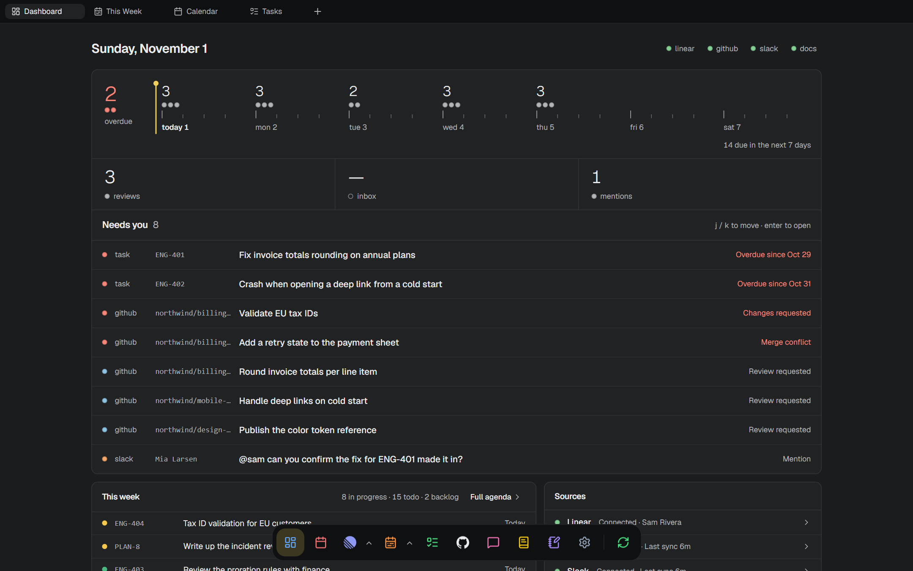

## Screenshots

| | |
| --- | --- |
| 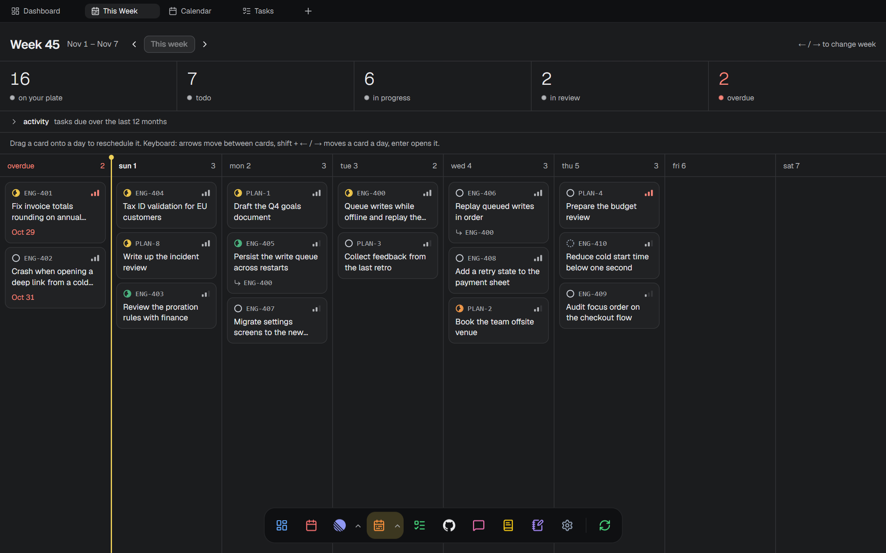 **This Week:** drag a card to another day to reschedule it | 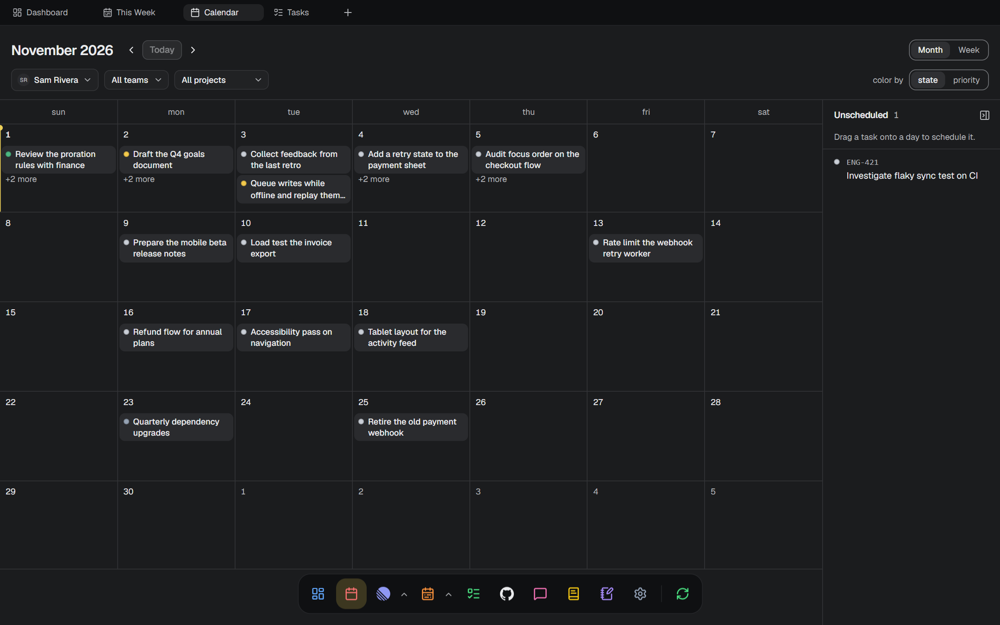 **Calendar:** month and week views with an unscheduled rail |
| 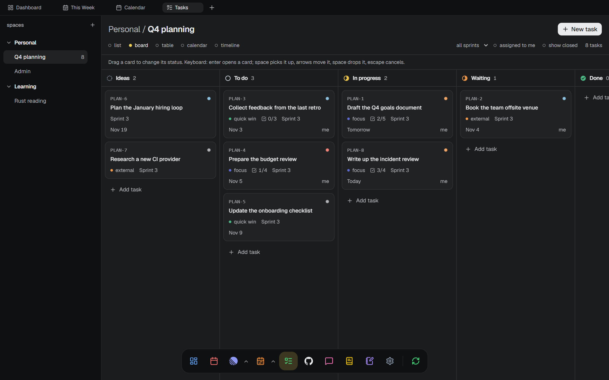 **Local tasks:** spaces, lists, custom workflows and five views | 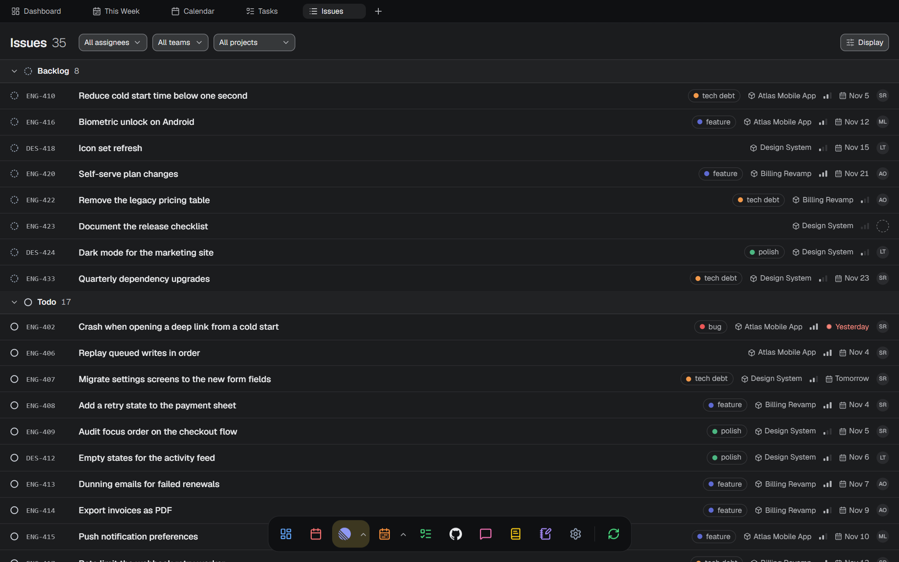 **Issues:** Linear issues grouped and filtered your way |
| 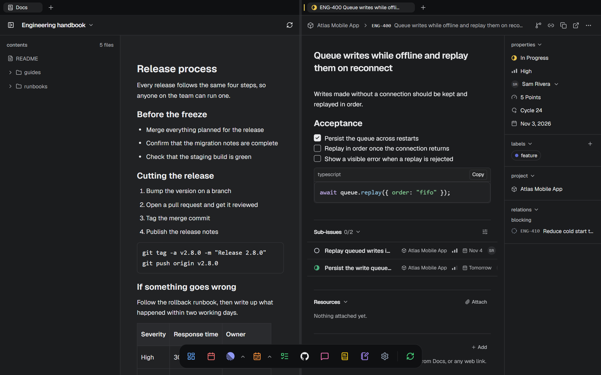 **Split view:** two independent panes, here a doc beside an issue | 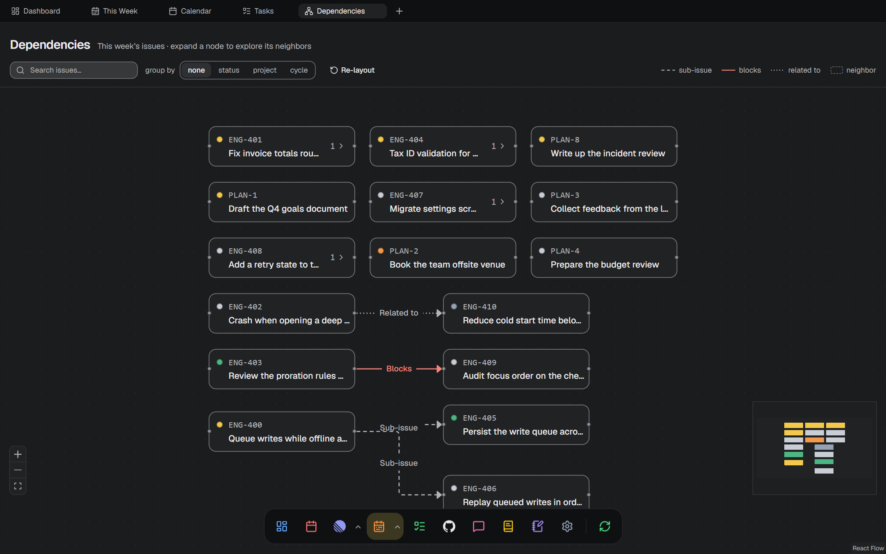 **Dependencies:** blockers and sub-issues as a graph |
| 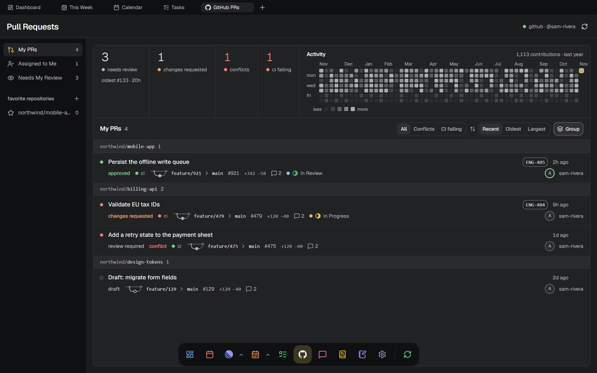 **Pull requests:** review queues, CI and conflict status | 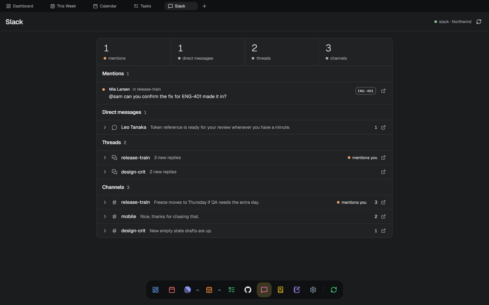 **Chat catch-up:** unread mentions, messages and threads |
| 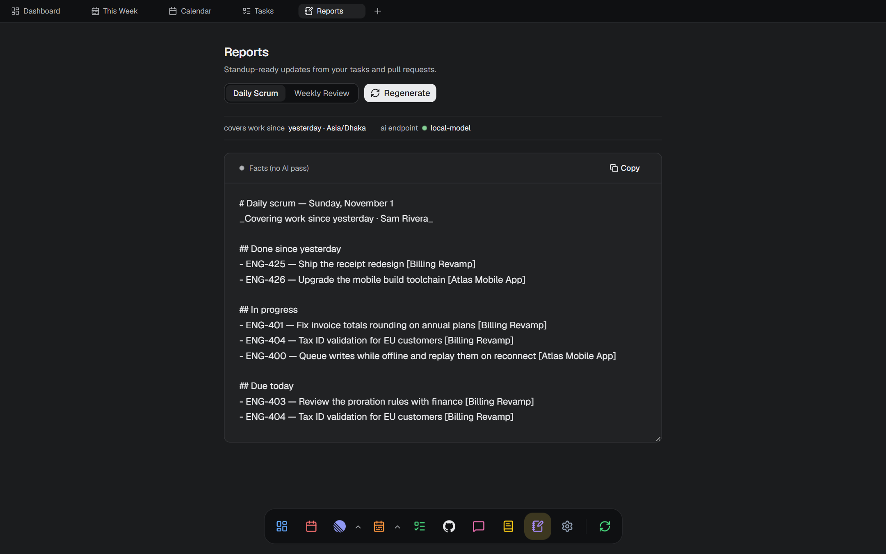 **Reports:** daily scrum and weekly review drafts | 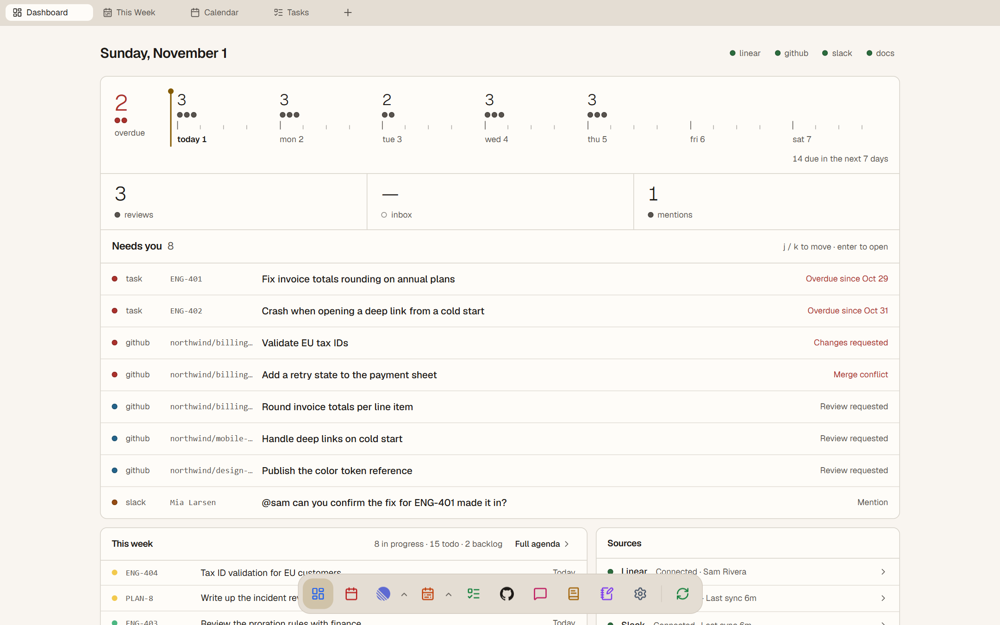 **Finishes:** two dark and two light |

Screenshots show fictional sample data.

## Install

Download the installer from the [latest release](https://github.com/Abrar118/astryn/releases/latest).

- **Windows (x64):** run `Astryn_5.0.1_x64-setup.exe`. It installs per-user and needs no admin rights. The installer is unsigned, so Windows SmartScreen may warn when you run it.
- **macOS and Linux:** v5.0.1 has no prebuilt installer yet. [Build from source](#building-installers) on the target OS.

On first run, a picker lets you choose which modules and screens to turn on.

## Features

### Dashboard

- **Landing view** that opens on launch with at-a-glance readouts, a ranked **attention queue** across your active sources, a due-date load scale, and an agenda for the week.
- **Source status panel** — shows the state of each integration, and Linear, GitHub and Slack link straight to their Settings panes.
- **Reads the cache only** — the Dashboard never starts provider syncs of its own.

### Local tasks

- **A tracker that doesn't need Linear** — tasks live in SQLite as the source of truth, and can run alongside Linear or on their own.
- **Spaces → lists → tasks** with subtasks, custom workflows per space (with per-list overrides), sprints, labels, checklists, dependencies, comments, and links.
- **List, Board, Table, Calendar, and Timeline views.**
- **Combined planning** — tasks assigned to you with a due date appear in This Week next to Linear issues. The Calendar, Dependencies, Reports, and Dashboard screens also merge every active tracker.
- **Backups** — daily automatic JSON backups (14 kept), plus manual export and restore.
- **One-way Linear import** — copy a Linear team's issues into local tasks.

### Calendar & scheduling

- **Month and week views** (FullCalendar) computed in `Asia/Dhaka` with weeks starting Sunday.
- **Drag-to-reschedule** — drag an event to another day to update its due date, with optimistic updates and rollback on failure.
- **Unscheduled rail** — issues without a due date sit in a side rail; drag one onto a day to schedule it.
- **Configurable workdays** — choose which days count as work days; non-workdays are hidden from the calendar.
- **Color by state or priority**, filters for team / assignee / project, and clear overdue flagging.
- **Rich issue hover-card** on event chips and a full **right-click issue menu** for inline edits.

### Issue workspace

- **List view** grouped by status, assignee, priority, or project, with display controls (ordering, completed-issue handling, sub-issue visibility, per-column toggles) that persist across launches.
- **Board view** — a Kanban grouped by status / assignee / priority; drag cards between columns to apply the implied change.
- **Create issues** from a modal or the command palette, with team, state, priority, due date, assignee, labels, project, cycle, and estimate.
- **Right-click context menu** on any issue for fast edits, copy actions, "open in Linear", "open in full page", and "open in right split".

### Issue details

- **Shared detail view** rendered either as a side drawer (non-modal — the calendar stays interactive) or as a full-page workspace tab.
- **Inline-editable properties**: state, assignee, priority, due date, title, labels, project, cycle, estimate, and team.
- **Markdown description editor** (Milkdown) with GitHub-flavored Markdown, Mermaid diagrams, fenced code blocks, images (proxied through Rust), and issue mentions with hover previews.
- **Comments** — Linear-style threads with replies, emoji reactions, `@`-mentions, and mention hover-cards; create, edit, and delete.
- **Sub-issues, relations, attachments**, and a per-issue **activity timeline** with semantic, color-coded event icons.

### Planning & overview

- **"This Week" board** — your tasks from every active tracker, laid out by due date for the Sunday-started week (`Asia/Dhaka`): an **Overdue** column plus a column per day. Drag a card to another day to reschedule it, or use **Shift + ← / →** on the keyboard. Readouts summarize the week, and a fold-out 12-month activity heatmap jumps to any week.
- **Dependency graph** — a React Flow visualization of parent/child hierarchy and issue relations (blocks / blocked-by / related / duplicate) as styled edges, with grouping and bulk actions; click a node to open its detail.

### Pull requests

#### GitHub

- **Master-detail PR workspace** with three `@me` queues — **My open PRs**, **Assigned to me**, and **Needs my review** — resolved server-side and deduped per queue.
- **Favorite repositories as scopes** — star a repo to get a scope containing all of its open PRs, backed by a searchable catalog of every repository you can reach. Group-by-repository is on by default and remembered.
- **Read-only PR drawer** with an **Overview** tab (cached-first, then live detail) and a **Diff** tab rendering unified file patches.
- **Per-PR badges** — open/draft, CI status, merge-conflict, and review decision, alongside author + avatar, comment count, repo, and relative update time.
- **GitHub contribution heatmap** — your real contribution calendar for the last year, beside Open / Needs-review / Changes-requested / Conflict metric tiles.
- **Linear chip** — a PR whose branch or title carries an issue identifier (e.g. `ENG-123`) links straight to that issue's tab in Astryn.
- **Classic PAT** stored in the OS keychain; degrades to a quiet "Connect GitHub" prompt when no token is set. Offline-first per-bucket cache with background sync.

#### Bitbucket Cloud

- **Its own PR workspace** with **My PRs**, **Needs My Review** (derived from favorite repositories), and favorite-repository scopes.
- **Cached-first Overview and Diff drawer**, shared with the GitHub workspace.
- **Atlassian API token and account email** stored in the OS keychain. Not yet verified against a live Bitbucket account.

### Chat catch-up

#### Slack

- **Catch-up board** of what you missed: unread **conversations** (channels, DMs, and group DMs) with unread and unread-thread counts, a **mentions** feed, and a **threads** list, each flagged when it mentions you.
- **Inline reader** for a conversation's messages without leaving the app.
- **Linear cross-links** — a Slack message carrying an issue identifier resolves to that issue and opens it in Astryn.
- **Deep links** back into Slack proper, resolving to both the desktop app (`slack://`) and web URL.
- **Credential auto-detection** from a local Slack install where supported, or paste them manually; stored in the OS keychain with an explicit connected / unverified / not-configured status.

#### Microsoft Teams

- **Catch-up board** for unread Teams chats and @mentions, on the same board as Slack.
- **Device-code sign-in** through Microsoft Graph, using your own app registration's client ID. Not yet verified against a live tenant.

### Documentation browser

- **Three source types** that can be used together:
  - **GitHub repositories** — add any repo by URL or `owner/repo[/tree/branch]`. Files are cached for offline reading, and your GitHub token is reused.
  - **Local folders** — Markdown, plain text, and PDF files read in place, never copied, and rescanned on demand. PDFs render as real pages.
  - **ClickUp Docs** — pages cached for offline reading, with a ClickUp token in the OS keychain. Not yet verified against a live ClickUp account.
- **Source switcher** in the page header, remembered as the default for new tabs — and because a doc is a tab, two split panes can read two different sources side by side.
- **Per-task "Docs & links"** — attach web links or documents from any source to a Linear issue or local task, with a title, note, and tags. Links are stored locally.

### Reports

- **Daily scrum and weekly review generators** over a `Asia/Dhaka` window that respects your configured workdays.
- **Deterministic fact sheet first** — the Markdown summary of what actually moved is always produced from your cached data, with no model involved.
- **Optional LLM prose pass** on top, streamed token by token. Any **OpenAI-compatible endpoint** works (hosted or local) — configure a base URL, model, and optional API key; a Test button lists the models the endpoint reports. Reasoning-model `<think>` spans are stripped from the output.
- With no endpoint configured the fact sheet still generates; a failed model pass surfaces a sanitized reason and never loses the deterministic half.

### Inbox

- **Linear notifications** in the dock, in a master-detail layout that reuses the shared issue detail for inline viewing, with explicit error and "all caught up" states.

### Workspace & navigation

- **Browser-style tabs** across fourteen views — dashboard, calendar, issues, this week, dependencies, inbox, tasks, GitHub PRs, Bitbucket PRs, Slack, Teams, docs, reports, settings — plus pinned issue and document tabs; layout persists across reloads.
- **Two-pane split view** — split the workspace into two independent tab groups with a resizable divider (pointer and keyboard), pane swapping, and drag-to-split.
- **Three ways to fill the right pane**: drag a tab across, right-click a tab to split, or pick an issue from the issue context menu / command palette.
- **Drag-and-drop on @dnd-kit** for both tabs (reorder, move across panes, drag-to-split) and board cards — pointer **and** keyboard accessible.
- **Command palette** (`⌘/Ctrl + K`) for issue search, creation, go-to navigation across every view, resync actions, and opening a selected issue directly in the right split.
- **Keyboard shortcuts**: `⌘/Ctrl + T` new tab, `⌘/Ctrl + W` close tab, `⌘/Ctrl + [` back, `⌘/Ctrl + R` resync, `⌘/Ctrl + Shift + R` full resync, and `C` to create an issue.
- **Appearance controls** — four finishes (Graphite and Charcoal dark, Paper and Stone light), plus independent app zoom, icon scale, and editor text scale.
- **Modules and screen switches** — turn any integration or feature on or off in Settings → Modules, or switch off Issues, This Week, Dependencies, and Inbox one by one. Disabling keeps tokens and cache; "Remove module data" deletes them.

### Foundation

- **Local-first data layer** backed by SQLite for fast cache reads and resilient, persisted workspace state.
- **Secure authentication** — provider and LLM credentials stored in the operating-system keychain, never in SQLite or returned to the webview.
- **All external API calls run in Rust**, exposed to the renderer as typed Tauri commands; the webview never receives a token.
- **Optimistic updates and background sync** with rollback handling, and all sync / error / rate-limit feedback through `goey-toast`.

## Premise

Remote providers such as Linear remain the source of truth for their data, and Astryn is the focused desktop workspace around them. Local tasks are the exception: they exist only in Astryn's SQLite database, which is why they have backups. The Rust core owns credentials, API access, synchronization, and SQLite persistence. The React renderer consumes typed Tauri commands and never receives API secrets.

This boundary lets the interface read from the local cache while each remote service stays its own canonical system.

## Architecture

| Layer | Responsibility |
| --- | --- |
| Tauri 2 | Desktop shell, command boundary, packaging |
| Rust | Provider and LLM access, keychain integration, sync, SQLite |
| React 19 + TypeScript | Workspace, calendar, task editing, command palette |
| TanStack Query | Renderer-side server-state coordination and optimistic updates |
| SQLite | Offline provider cache, sync state, app-owned metadata, and local tasks |

All outbound requests run in Rust. Tokens are stored through the OS keychain and are not written to local storage, SQLite, or frontend environment files.

## Requirements

To build from source:

- Node.js 20 or newer
- Rust stable toolchain
- [Tauri 2 platform prerequisites](https://v2.tauri.app/start/prerequisites/) for your operating system

Each integration is optional, and only needs its credentials if you turn it on. Add them in Settings:

- **Linear:** a personal API key
- **GitHub:** a **classic** personal access token (`repo` scope), for pull requests and documentation repositories
- **Bitbucket Cloud:** an Atlassian API token with the Bitbucket scopes `read:user`, `read:workspace`, `read:repository`, and `read:pullrequest`, plus your account email
- **Slack:** credentials auto-detected from a local Slack install where possible, or pasted manually
- **Microsoft Teams:** your own Microsoft app registration's client ID, and optionally a tenant
- **ClickUp:** an API token
- **AI:** any OpenAI-compatible LLM endpoint, hosted or local, for the report prose pass

## Development

```bash
npm install
npm run tauri dev
```

`npm run tauri dev` is the primary loop: it launches the desktop app and runs Vite for you, so the Rust commands, SQLite cache, and keychain integration are all available. (`npm run dev` starts only the web frontend and cannot reach the Rust backend.)

## Building installers

Astryn packages to native installers for each platform via Tauri.

```bash
# Production desktop build for the current OS
npm run tauri build
```

Output lands in `src-tauri/target/release/bundle/`. The bundle `targets` is set to `all`, so each OS produces its native formats:

- **macOS** — `.app` and `.dmg`
- **Windows** — `.msi` and NSIS `.exe` (requires WebView2 + the MSVC toolchain)
- **Linux** — `.deb` and `.AppImage` (requires `libwebkit2gtk-4.1-dev`, `build-essential`, `libssl-dev`, `libayatana-appindicator3-dev`, `librsvg2-dev`, and a running Secret Service daemon such as `gnome-keyring`)

Tauri does not cross-compile desktop bundles — build each target on its own operating system.

## Quality checks

```bash
npm test                                                  # frontend tests (Vitest)
npm run build                                             # tsc typecheck + Vite build (frontend only)
cargo test  --manifest-path src-tauri/Cargo.toml          # Rust unit tests
cargo clippy --manifest-path src-tauri/Cargo.toml         # Rust lints
cargo fmt   --manifest-path src-tauri/Cargo.toml -- --check # Rust formatting
```

## Current scope

Astryn targets a single-user workflow and currently delivers the dashboard, local tasks, calendar, issue workspace, detail editing, activity timeline, the "This Week" board, the dependency graph, the GitHub and Bitbucket pull-request workspaces, the Slack and Teams catch-up boards, the documentation browser with per-task doc links, the daily and weekly report generators, the inbox, the command palette, and the two-pane split workspace. See [`requirements.md`](requirements.md) for the full plan.

## License

Licensed under the [Apache License 2.0](LICENSE).

Copyright 2026 Abrar Mahir Esam - ME.
